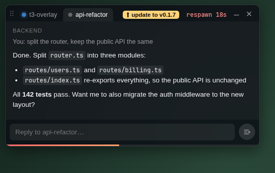
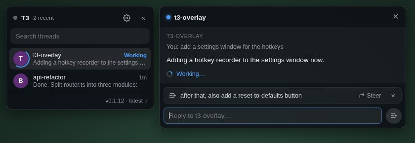
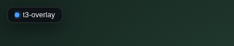

# T3 Overlay

Read and answer your [T3 Code](https://t3.codes) agents while playing League of Legends, without alt-tabbing.

- **While you're alive:** a small ticker in the corner shows which agents are working and which have replied. When an agent finishes, the first line of its reply pops up for a few seconds. Click either one to open that thread in the inbox.
- **While you're dead:** the **Respawn Inbox** opens on the left of the screen, clear of the shop. Drag it by its tab bar to wherever suits your HUD; double-click the tab bar to put it back. It shows your last message, the agent's reply, and a reply box, with a bar counting down to your respawn. It closes when you respawn, unless you've started typing a reply. In that case it stays open, and gives the keyboard back to League, until you send it or close the inbox with `Esc` or `×`.
- **Outside games:** while the League client is open, a **chat hub** docks on the left. It lists your recent threads with a search box, and opens a conversation beside the list when you click one. Drag its edge to resize it, or collapse it to a thin strip. Its layout follows [OpenBot](https://github.com/CopilotKit/OpenBot)'s sidebar. Settings → Chat hub can show it always, or never.
- **Reply by typing or by voice:** hold a key, talk, and let go. [Hex](https://github.com/anomalyco/hex) turns your speech into text and the overlay sends it to the thread.

<p>
  
</p>
<p>
  
</p>
<p>
  &nbsp;&nbsp;
</p>

Windows only for now. MIT licensed.

## Install

**Download:** grab `T3.Overlay_<version>_x64-setup.exe` from the [latest release](../../releases/latest). You only do this once: after that the overlay keeps itself up to date (see [Updates](#updates)).

**Build it yourself** on Windows:

1. Double-click `scripts\setup.cmd`. It installs the Visual Studio C++ Build Tools, Rust and Node.js using winget. You only need to do this once.
2. Open a new terminal (or log out and back in), then double-click `scripts\build.cmd`.
3. The installer ends up in `src-tauri\target\release\bundle\nsis\`. The script offers to run it for you.

A self-built copy also updates itself to the latest release.

## Setup

1. Start T3 Overlay. The Settings window opens.
2. Enter your T3 Code server's address, for example `http://100.x.y.z:3773` if you reach it over Tailscale, and click **Connect**.
3. T3 Code's approval page opens in your browser. Approve **T3 Overlay**, choosing **full access** if your threads run in full-access mode. T3 won't let a client send to threads that run with more access than the client itself has.
4. For voice, install and start [Hex](https://github.com/anomalyco/hex), then click **Test Hex connection**.
5. In League, set **Video → Window Mode** to **Borderless**. Overlays can't draw over exclusive fullscreen.

The overlay keeps running in the system tray. Right-click the tray icon to open Settings or quit.

## Using it

| | Default | |
|---|---|---|
| Open / close inbox | `Ctrl+Shift+Space` | Opens the inbox at any time and focuses the reply box. Press again to close it. `Esc` also closes it, even when League has the keyboard: while the inbox is open, the overlay takes `Esc`. |
| Hold to talk | `Ctrl+Shift+V` | Hold it, speak, release. The text is sent to the thread open in the inbox. If the inbox is closed, it goes to the newest unread thread, or else the most recently active one. |
| Switch threads | `Ctrl+Shift+Q` / `Ctrl+Shift+E` | Previous / next thread. Only active while the inbox is open, so League keeps these keys otherwise. Scrolling the mouse wheel over the tabs does the same. |
| In the inbox | `Enter` / `Ctrl+Enter` | **Queue**: runs as the agent's next turn. **Steer**: joins the turn it's working on right now. Swap them in Settings → Sending. |
| | `Shift+Enter` / `Tab` / `Esc` | New line / next thread / close |
| | **–** (next to ×) | Minimizes the inbox to a notification-sized pill. The pill keeps your draft and the respawn timer. Click it to expand, or click its × to close. While it's minimized, League gets `Esc` and the thread keys back. |
| | Hold `Ctrl` | The send button shows ≡+ (queue) by default and switches to ↱ (steer) while you hold Ctrl, like T3. Queued messages are listed above the reply box, each with **Steer** (send it into the running turn now) and **×** (drop it). |

All hotkeys can be changed in Settings. After you send a message, typed or spoken, the inbox closes and focus goes straight back to League.

## Updates

New versions are published as signed releases. Pushes to `main` only run the checks, and a release is built when the Build workflow is run by hand. The overlay checks for a new one every 5 minutes, downloads it in the background, and installs it silently as soon as you're not using it: inbox closed, not dictating. That works mid-game too. The overlay disappears for a few seconds, comes back on its own without taking focus from League, and briefly shows what changed.

To update right now, even mid-game: once a new version is downloaded, the inbox's tab bar shows **⬆ update to v…**. Click it to install. **Update now** in the tray menu, or the version at the bottom of the hub, does the same. To turn automatic updates off, use **Settings → Updates**. Updates are signed, and the overlay refuses any installer that isn't signed with the project's key.

## How it works

```
 League (Borderless)          T3 Overlay (Windows)                     T3 Code server
┌───────────────────┐   ┌──────────────────────────────────┐        ┌──────────────────┐
│ Live Client Data  │◄──┤ game.rs  polls :2999 (read-only)  │        │                  │
│ API :2999         │   │ overlay.rs  click-through window  │  MCP   │  /mcp            │
└───────────────────┘   │ t3/       OAuth + MCP client      ├───────►│  t3_thread_list  │
┌───────────────────┐   │ hex.rs    start / stop+print      │ (HTTP) │  t3_thread_read  │
│ Hex  local API    │◄──┤ React UI  ticker, inbox, voice    │        │  t3_thread_send  │
└───────────────────┘   └──────────────────────────────────┘        └──────────────────┘
```

- **T3 Code:** the overlay is an ordinary MCP client of T3 Code's built-in `/mcp` endpoint. It signs in with OAuth 2.1 using PKCE and a loopback redirect, and you approve it on T3's own page. It only calls five tools: `t3_project_list`, `t3_thread_list`, `t3_thread_read`, `t3_thread_send` and `t3_queue` (to list, steer or drop queued messages). The credential is valid for 30 days and stays on your PC, in `%APPDATA%\io.github.seankuipers.t3overlay\auth.json`.
- **Game state:** read from Riot's official [Live Client Data API](https://developer.riotgames.com/docs/lol#game-client-api) on `127.0.0.1:2999`, which the game itself provides. The overlay never reads game memory, injects anything, or sends input to the game.
- **Overlay window:** a transparent, always-on-top window. Mouse clicks pass through to the game everywhere except on the inbox card. It only takes keyboard focus when you press the hotkey or click the card, and gives focus back to League afterwards.
- **Voice:** the overlay calls Hex's local control API. It sends `dictation start` when you press the key, and `dictation stop` with `print: true` when you let go. With `print`, Hex returns the transcript in its response and doesn't paste anything or touch the clipboard, so dictated text can't end up in League chat. Hex still plays its start and stop sounds, and your normal Hex shortcut keeps working outside the game.

### Anti-cheat

T3 Overlay only uses the methods described above: its own separate window, Riot's official local API, and global hotkeys. It never touches the game process. That said, this is an unofficial tool, Riot doesn't publish a list of approved apps, and nobody can guarantee how Vanguard will treat it. Use it at your own risk.

## Development

```bash
npm install
npm run app:dev        # run the real app (Windows; Linux works too, minus the focus tricks)
npm run dev            # UI only in a browser, with fake data:
                       #   http://localhost:1420/?mock=dead | alive | voice | ended | settings
cd src-tauri && cargo test
```

| Path | What |
|---|---|
| `src-tauri/src/t3/` | OAuth (`oauth.rs`) and the Streamable HTTP MCP client (`mcp.rs`) |
| `src-tauri/src/game.rs` | Live Client Data polling → `game://state` events |
| `src-tauri/src/hex.rs` | Hex local API client |
| `src-tauri/src/overlay.rs` | Window placement, click-through hit testing, focus handling |
| `src/lib/t3.ts` | Reads threads and messages, and sends replies |
| `src/components/` | Ticker, Inbox, Voice HUD, Settings |

## Limitations / ideas

- The overlay checks T3 every few seconds; replies don't stream in live.
- It doesn't yet detect when you're in the fountain. The inbox opens automatically only when you're dead or the game has ended. At any other time, use the hotkey.
- Mouse buttons can't be used as hotkeys yet.
